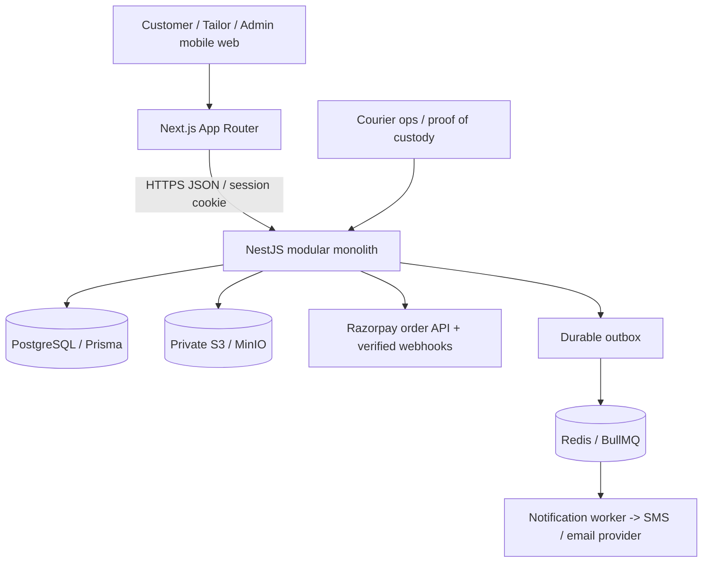

# Architecture

**One owner of transactional business state:** NestJS API. Worker only delivers outbox notifications; it never mutates order/payment/custody state. All important transitions are serialized using optimistic version checks and an `OrderStatusEvent` insert in the same Prisma transaction.

## Domain boundaries

- `auth`: OTP, secure sessions, server-managed roles
- `marketplace`: service zones, tailor onboarding/verification, addresses, measurements
- `media`: private S3 presign + verified S3 HEAD + authorized signed get
- `orders`: multi-item order creation, tailor acceptance and quotes, immutable accepted measurement snapshots, claims
- `payments`: provider checkout orders, webhook HMAC/unique event deduplication, dev-only simulator
- `logistics`: canonical inbound and outbound jobs, courier assignment, evidence and OTP custody
- `operations`: tailoring production, QC, material discrepancies, finance and admin audit
- `worker`: notification delivery with retry/backoff from durable outbox

## Important invariants

1. No paid status without a server-verified provider event (except dev-only simulation explicitly prevented in production).
2. Customer must approve the **latest valid** quote version before checkout.
3. Every quote/payout value is integer paise; accepted measurements are snapshots.
4. A verified courier handoff records parcel ID, seal, OTP, piece count and a private evidence file.
5. A paid garment must be received by the tailor before production starts; QC must pass before the separate outbound leg starts.
6. Completion is separate from stitching and requires return-delivery confirmation.
7. Payouts are held for open disputes and must be manually approved and recorded with external transfer reference.

## Resilience work remaining

Add database-ledger double-entry postings, a distributed lock/advisory serializable barrier for stricter high-volume finance flows, webhook recovery/reconciliation against provider APIs, and full negative E2E tests before live launch. Some concurrency barriers exist now but were not load-tested.
